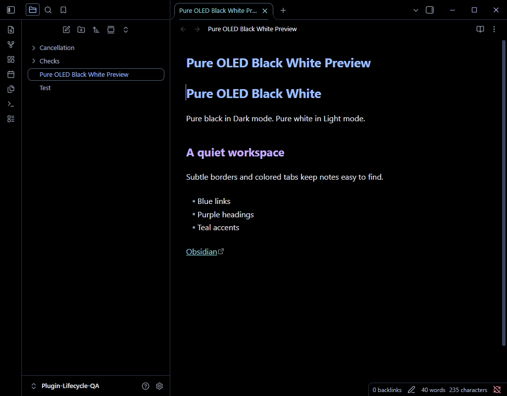
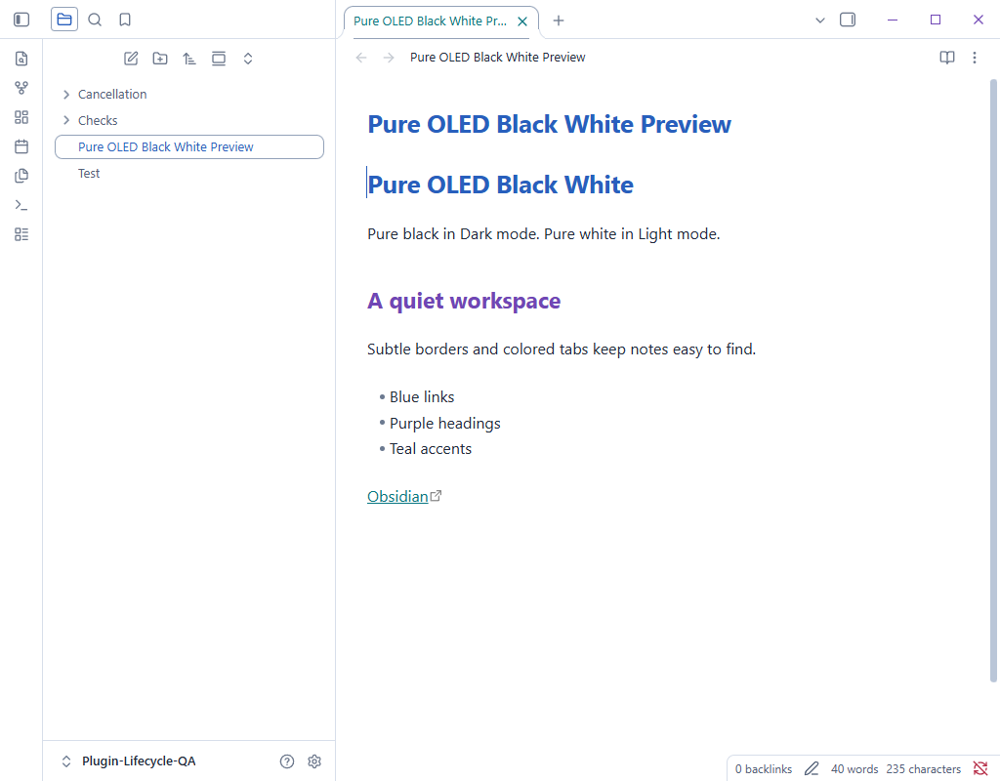

# Pure OLED Black White

A palette for the default Obsidian interface. Dark mode uses pure black (`#000000`) surfaces. Light mode uses pure white (`#ffffff`) surfaces. No gray panel backgrounds.

Subtle blue-gray borders and shadows separate panels, menus and controls. Blue, purple and cyan distinguish titles, tabs and links. Headings, code syntax and status messages use coordinated colors. Text selection and search highlights retain visible color fills so selected content remains clear.

The theme inherits Obsidian's built-in layout, spacing, fonts and behavior. It changes color variables and adds small border and shadow rules. No plugins, scripts, remote assets, fonts, accounts or payments are needed. Third-party plugins with hardcoded styles may supply their own backgrounds.

## Preview

## Install manually

1. Create `.obsidian/themes/Pure OLED Black White/` in your vault.
2. Copy `manifest.json` and `theme.css` into it.
3. Open Settings > Appearance and select Pure OLED Black White.
4. Choose Dark or Light under Base color scheme.

Version: 3.4.1. Minimum Obsidian version: 1.10.6. Supported modes: Dark and Light.

## Official references

- [Build a theme](https://docs.obsidian.md/Themes/App%20themes/Build%20a%20theme): override CSS variables to retain the default app styling.
- [Color variables](https://docs.obsidian.md/Reference/CSS%20variables/Foundations/Colors): base, semantic and accent colors.
- [Developer policies](https://docs.obsidian.md/community-directory/developer-policies): licensing, readable source and no network-loaded theme assets.
- [Submit your theme](https://docs.obsidian.md/Themes/App%20themes/Submit%20your%20theme): requires a README, license, screenshot (512 x 288 recommended), manifest, and matching versioned GitHub release with `manifest.json` and `theme.css` attachments.

MIT licensed. Independent community theme by TutivSoft. Obsidian's default stylesheet remains supplied by Obsidian and is not redistributed here.
