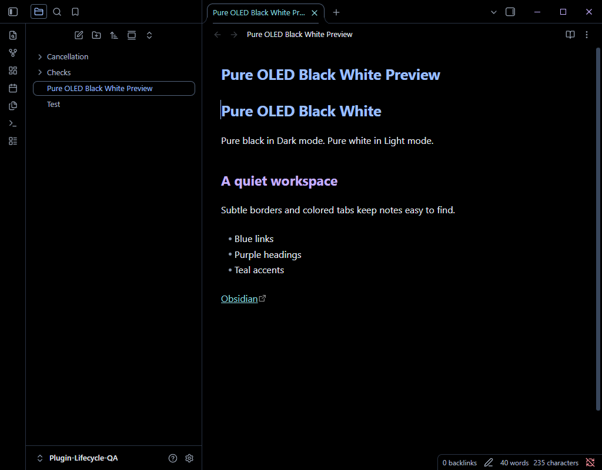
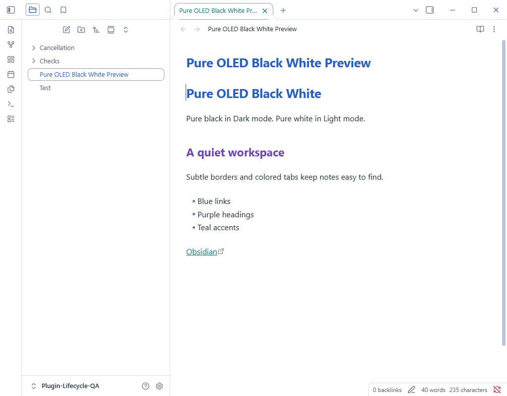

# Pure OLED Black White

A palette for the default Obsidian interface. Dark mode uses pure black (`#000000`) surfaces. Light mode uses pure white (`#ffffff`) surfaces. No gray panel backgrounds.

Subtle blue-gray borders and shadows separate panels, menus and controls. Blue, purple and cyan distinguish titles, tabs and links. Headings, code syntax and status messages use coordinated colors. Progress indicators, checked items, text selection and search highlights use colored fills so their states stay visible.

The theme inherits Obsidian's built-in layout, spacing, fonts and behavior. It changes color variables and adds small border and shadow rules. No plugins, scripts, remote assets, fonts, accounts or payments are needed. Third-party plugins with hardcoded styles may supply their own backgrounds.

## Preview

## Install from Obsidian Community

Open **Settings > Appearance > Themes > Manage**, search for **Pure OLED Black White**, and select the theme to install and apply it. Choose Dark or Light under **Base color scheme**.

[Obsidian Community listing](https://community.obsidian.md/themes/pure-oled-black-white)

## Install manually

1. Create `.obsidian/themes/Pure OLED Black White/` in your vault.
2. Download the matching `manifest.json` and `theme.css` attachments from the [GitHub releases page](https://github.com/tutivsoft-com/pure-oled-black-white/releases) and copy them into that folder.
3. Open Settings > Appearance and select Pure OLED Black White.
4. Choose Dark or Light under Base color scheme.

Version 3.5.1 on `main`. Requires Obsidian 1.10.6 or later. Supports Dark and Light.

## Check locally

With Python and the `tinycss2` and `cssselect2` packages installed, run `python -B -m unittest discover -s tests` from the repository root. The checks cover colors and control states in both modes, CSS syntax, and version consistency.

## Official references

- Override CSS variables to retain the default app styling. [Build a theme](https://docs.obsidian.md/Themes/App%20themes/Build%20a%20theme)
- Look up base, semantic and accent colors. [Color variables](https://docs.obsidian.md/Reference/CSS%20variables/Foundations/Colors)
- Review licensing, readable source and network asset requirements. [Developer policies](https://docs.obsidian.md/community-directory/developer-policies)
- Prepare a README, license, screenshot (512 × 288 recommended), manifest and GitHub release with matching `manifest.json` and `theme.css` attachments. [Submit your theme](https://docs.obsidian.md/Themes/App%20themes/Submit%20your%20theme)

MIT licensed. Independent community theme by TutivSoft. Obsidian's default stylesheet remains supplied by Obsidian and is not redistributed here.
